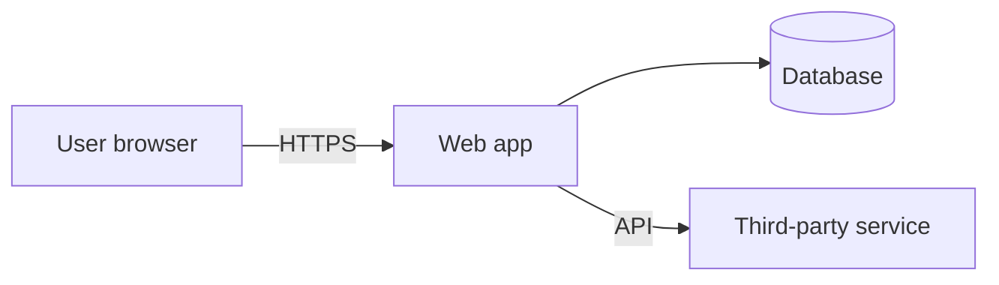

# Threat Model: <system / feature>

Date: <date>   Owner: <name>   Version: <commit/tag>   Method: STRIDE / attack tree

## 1. Description
<what is being built; link to design>

## 2. Data-flow diagram

Trust boundaries: <list>

## 3. Assets
| Asset | Sensitivity | Where stored/processed |
|---|---|---|

## 4. Entry points
| Entry point | Auth required | Actor(s) |
|---|---|---|

## 5. Actors
<anonymous, user, other-tenant user, admin, insider, compromised dependency, automated bot, ...>

## 6. Threats
| ID | STRIDE | Threat (actor does X via Y to achieve Z) | Likelihood | Impact | Control(s) and location | Test / alert | Status |
|---|---|---|---|---|---|---|---|

## 7. Assumptions
## 8. Out of scope / not modeled
## 9. Residual risk and decisions
## 10. Follow-ups
